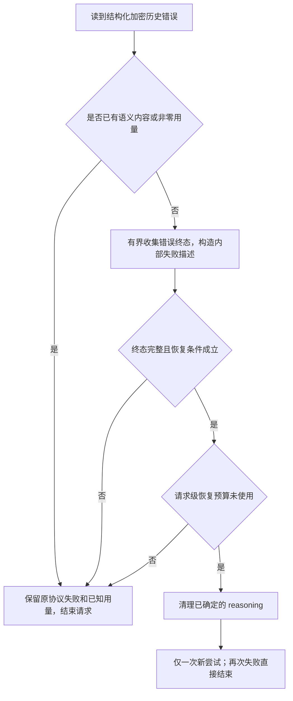
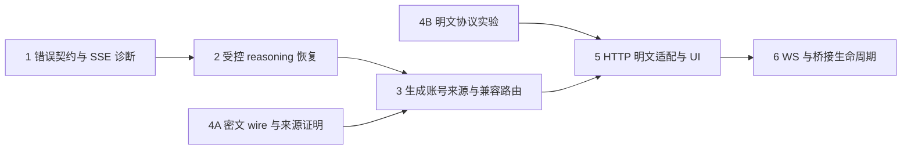

# #7708：Responses 加密历史失败的识别、恢复与预防

状态：设计稿，尚未实现。日期：2026-10-09。

修改源为 [Aqr-K/sub2api](https://github.com/Aqr-K/sub2api)，官方上游为 [Wei-Shaw/sub2api](https://github.com/Wei-Shaw/sub2api)。设计基线固定为 `3a6fd1c9db07203ca308aaba69e502bc1f35b307`（0.2.15）；故障报告使用 0.2.4 / `5de5e2bed035d43591a2e10e51f420ef6a84eb98`。本文件所在分支为 `docs/issue-7708-recovery-plan`。

## 1. 目标与完成口径

[#7708](https://github.com/Wei-Shaw/sub2api/issues/7708) 的上游返回 HTTP 200，再在 SSE 中报告 `invalid_encrypted_content` / `Encrypted function output content could not be decrypted or decoded.`。现有 HTTP 400 reasoning 恢复不会处理它；工具消息也不在现有清理与失效历史追踪范围。

本方案交付三种明确行为：

1. **能判定不能恢复时，保留上下文并明确结束**：识别准确的语义错误，保留上游错误码和协议格式，解释继续重放原历史为何无效。不能把请求错误当成账号失效，也不能把 HTTP 200 当作成功。
2. **具备证据时恢复或避免不兼容路由**：reasoning 可按严格条件清理并最多重试一次；工具密文只能在首次转发前按可信来源约束到生成账号，不能套用 reasoning 删除规则。
3. **为新协作消息提供可选择的预防路径**：在协议和真实客户端验证通过后，允许指定协作工具生成明文任务参数。默认关闭，不声称能修复旧密文。

不把“新增错误提示”“reasoning SSE 可重试”单独称为 #7708 已完整修复。旧工具历史在没有可用生成端、没有可验证恢复接口时，通用无损恢复不可实现；交付说明必须保留这个边界。

首次密文失效的根因尚未由 #7708 现场证实。相关 [#7506](https://github.com/Wei-Shaw/sub2api/issues/7506) 支持部分后端之间存在加密历史不兼容，但不能推定所有账号互不兼容，也不能只凭 model/base_url 相同认定可互换。

## 2. 已核对的代码边界

| 现有位置 | 本次设计需要解决的边界 |
| --- | --- |
| `backend/internal/service/openai_gateway_forward.go:1094`、`:1117`、`:1224` | 加密恢复要求 HTTP 400；SSE 出错后通常直接返回，没有恢复信号交回请求循环 |
| `openai_gateway_response_handling.go:525` | 普通 SSE 路径解析 `error`/`response.failed`，随后可能提交失败事件；恢复决策必须在不可撤回输出前进行 |
| `openai_gateway_passthrough.go:387`、`:1550`、`:1602`、`:2063` | 自动透传走独立循环；裸 error 和 response.failed 分类不同，两条路径都需覆盖 |
| `openai_gateway_response_handling.go:1715`、`openai_gateway_passthrough.go:2373` | stream=false 的 SSE-to-JSON 失败会提前转成通用错误并丢失用量；必须在两处转换前接入 |
| `openai_gateway_request_body.go:428` | sanitizer 只处理 reasoning/compaction，其他 item 原样保留 |
| `openai_encrypted_content_lineage.go:32` | 同样只记录 reasoning/compaction 的顶层 encrypted_content 摘要 |
| `backend/internal/handler/openai_gateway_handler.go:798`、`:820` | 转发、释放账号槽位和结算在不同层；错误上的部分 result 可能被结算，不能新增第二次用户扣款 |
| `openai_account_scheduler.go:451`、`:495` | session sticky 可以失效或 escape；本地账号相同也不证明第三方内部后端相同 |
| `internal/pkg/apicompat/chatcompletions_responses_bridge.go:657` | agentMessageText 仅拼接字段，不会解密真正的工具密文 |

相对路径未写前缀时均位于 `backend/internal/service/`。更完整取证见 [source evidence](issue-7708-source-evidence.md)。实施前必须重新 fetch 并检查热点文件漂移，不按旧行号机械修改。

## 3. 错误与恢复的数据模型

新增独立文件 `openai_encrypted_history_recovery.go`，避免继续向大文件嵌入识别规则。建议的内部类型如下，字段名称可在实现时遵循项目风格调整：

```go
type EncryptedHistoryFailure struct {
    Kind              EncryptedHistoryKind // reasoning / tool_output / unknown
    Origin            FailureOrigin        // HTTP body / SSE error / response.failed
    UpstreamCode      string
    UpstreamParam     string
    UpstreamRequestID string
    OutboundBodyID    string                // 仅内部的实际出站 body 身份
    ItemEvidence      []EncryptedItemRef    // 路径、类型、证据来源；不含任务正文
    Terminal          bool
    SemanticSeen      bool                 // 包括已缓存但尚未 flush 的语义输出
    SemanticCommitted bool
    Usage             AttemptUsage         // KnownZero / KnownNonzero / Unknown
}

type RecoveryDecision struct {
    Action RecoveryAction // ReturnError / StripReasoningOnce
    Reason string
}
```

此错误属于 **request/history scope**，不包装成普通 `UpstreamFailoverError` 扔给账号池轮询。记录诊断可以复用 ops，但不得自动禁用账号、递增失败健康惩罚或清除正常账号配额。

新增规则只接入 OpenAI 平台的原生 Responses 路径（API Key、OAuth-like 及其显式支持的透传形式）。不能仅因其他平台也使用兼容错误码，就改变 Grok/国产模型/Chat/Anthropic 桥的恢复策略。

识别必须从结构化 JSON 的 `error` / `response.error` 中读取 code、type、message、param：

- `invalid_encrypted_content` 可以确认加密历史类失败，**不能单独确认是 reasoning**。
- 与现有 #7703 一致的 `thinking_signature_invalid` + 精确校验/解密失败信息继续支持现有 HTTP 400 行为。
- function output / tool / agent 的明确错误证据优先归类 tool_output。
- param 的路径和下标必须针对**实际失败的出站 body**验证；入站到出站发生 item 重排时，不直接拿入站下标删除内容。
- 无足够类型证据、存在未识别的加密标记、字段含糊或畸形 JSON，归类 unknown，不从“请求里恰好有 reasoning”推断可以删除它。
- 不能把所有含 encrypted/signature 文本的错误都当作恢复触发器。

工具库存扫描需要识别已验证的 agent_message 嵌套 content 块以及函数参数加密元数据；未知加密结构必须使新增自动恢复降级为 ReturnError。不尝试靠“像 base64”判断真假密文。

## 4. HTTP/SSE 的错误生命周期



### 4.1 不能抢先 flush，也不能无限缓存

- 复用现有 SSE parser、semantic-output 判定和首输出 timeout，不另写简化行解析器。
- 在 `forceFlushFailedEvent` 以及现有错误透传规则提交响应之前识别可候选的加密错误。
- `response.failed` 是失败终态；裸 `error` 后可能还有终态与用量，不在首个错误帧立即重发。
- 仅对候选错误启用尾部收集，初始预算为 64 KiB / 250 ms，且不超过原请求剩余 deadline。该值需由传输测试和真实合成探测校准。
- 读到 `response.failed` 或干净 EOF 后才形成终态证据；超时、断流、超限视为不完整，不自动恢复；立即取消并关闭本次上游 reader，保证 reader goroutine 回收。
- 错误后若出现 `response.completed`/`response.done` 或语义输出，取消候选恢复，沿用对应终态语义；不得看到第一个 error 就把后续成功覆盖为失败。
- 注释心跳不属于语义内容，`Writer.Written()` 也不等于已经发出模型结果。`SemanticSeen` 和 `SemanticCommitted` 必须分别判断。
- 当前透传实现会先写本次上游 headers/`x-request-id` 再启动心跳；仅延后失败事件 flush 不够。需要将 attempt headers 暂存到本次结果私有状态，心跳只提交稳定的协议响应头，最终采纳某次尝试后才提交可提交的 headers。若失败尝试专属 headers 已提交则不得事后改写或假装未泄漏；新增恢复分支应回退为不可重试。仅稳定 SSE headers 被心跳提交仍可按其他条件恢复。包括 ordinary 与 passthrough 的 heartbeat-before-failure 用例。
- 任何文本、reasoning delta、工具调用、工具参数、图像/音频输出或未知潜在语义事件，都关闭新增自动恢复资格；仅明确允许的元数据事件可以缓存后丢弃。
- 已提交心跳、未提交语义时重试，只可复用原 SSE 响应；不可尝试修改 HTTP 状态，不可泄漏失败尝试的 response ID/account headers。

### 4.2 返回给客户端的形式

- HTTP 原始错误保持其状态码；SSE 保持流协议与上游 `invalid_encrypted_content`、错误 type 和必要原始信息。
- 在有明确工具密文证据且无恢复方式时，message 可追加简短建议：`Encrypted tool history cannot be recovered automatically. Retry on the original backend or start a new conversation.` 不暴露账号 ID、base_url 或内部任务身份。
- 内部 `history_unrecoverable` 等原因仅用于 ops/诊断；不要随意换成客户端未知的错误码，造成它误判为临时故障并重试。
- 已输出部分内容时按上游合法的终态序列结束；不能追加第二条完成事件或伪装 success，也不能把之后的失败事件吞掉。
- 本轮错误不能阻止客户端自行再次发起请求；“停止盲重试”指网关不会在账号池内无意义轮询，不承诺控制外部客户端行为。
- `stream=false` 但上游返回 SSE 时，在 `handleSSEToJSON` 和 `handlePassthroughSSEToJSON` 中，必须先于 `nonStreamingTerminalFailureFailover` / `writeOpenAINonStreamingProtocolError` 提取加密失败与原始 usage。尚未提交 headers 时，明确的历史校验拒绝返回 HTTP 400 的 JSON error，保留原 code/type；unknown 的加密类错误保持原分类的状态，不凭模糊文字改成 400。客户端预期 JSON 时不能返回 SSE 帧。
- 响应模式 JSON/SSE 与 headers 是否已提交分别记录。非流式 JSON 若已写合法空白 keepalive，则维持 HTTP 200，追加合法 JSON error（不能更改状态、不能切成 SSE）；已提交 SSE 则按 SSE error 结束。两种形式都不能输出假成功对象。

## 5. 有条件的 reasoning 恢复与工具历史兼容路由

### 5.1 reasoning 清理：补齐 SSE，不扩大删除范围

新增 SSE 自动恢复默认关闭，通过 `accounts.extra.openai_encrypted_history_recovery` 显式配置为 `reasoning` 后开启；缺失值为 `off`。原来 HTTP 400 已有行为先保持兼容。

兼容顺序必须明确：现有普通 Forward 的 HTTP 400 分支允许通用 `invalid_encrypted_content` 配合可清理 reasoning，并不要求新增 SSE 的类型/用量证明；不能把新门槛插在它之前而改变默认行为。透传原本没有同等 HTTP 400 加密重试，不能借共享分类器默默新增。新模式关闭时保留这些差异；启用后可以统一记录/限制恢复预算，但不能把“普通 HTTP 400 已有恢复”误判为 SSE 功能回归。

所有新增恢复必须满足：

1. 明确的 reasoning 错误证据，且没有 tool_output/未知加密结构或相互矛盾证据。
2. 无上游语义输出、无已提交语义输出。请求允许 MCP、服务器执行工具、图像/音频生成或其他上游副作用时，缺乏明确 provider“拒绝发生在执行和计费之前”的契约就不自动恢复；没有看到输出不证明服务器没有执行。只由客户端执行且尚未交付调用的普通函数可按其他条件判断。库存必须包含网关自动注入的 hosted tools，不能只看客户端原始 tools。
3. 终态完整，**明确报告零用量**；非零和未报告用量均不自动恢复。未知不等于免费。
4. sanitizer 确实改变实际出站 body；普通消息、工具调用、工具结果和未知字段保持原值，数字精度保持。
5. 本次入站请求的恢复预算未用，客户端尚未取消，原 deadline 允许。

`KnownZero` 必须由**原始 JSON 的完整、类型正确、显式的计量字段**证明，不能用 `OpenAIUsage{}` 的零值或 `openAIUsageFromGJSON` 的布尔返回值证明。现有解析会接受 `usage:{}` 并通过 `.Int()` 把缺失/非法字段变成零。实现时按支持的 provider usage schema 验证必需 input/output 计数及适用的 cached/reasoning/image/tool 等计费维度：非负整数、无字符串/null/浮点强制转换，相关总数一致。缺失、部分字段、未知计费维度或冲突为 Unknown；任何较早非零用量/副作用证据不可被较晚全零事件覆盖。此严格解析只用于新增恢复资格，不顺带重写全站用量计费解析。

新请求只在当前账号上重试一次。不能把参数修复和模型/账号故障切换混为一谈。只有被验证且实际移除的 reasoning 摘要可以写入 lineage，继续保留现有 TTL/容量边界；不能把所有 input 项标成坏历史。

**实用性限制**：#7708 常见裸 error 不携带 usage，这类响应默认不会进入新增自动重试。它仍能得到准确诊断。只有针对明确 provider 的独立证据证明验证拒绝不执行、不收费，才可在后续 ADR 中引入 provider 专属例外；本方案不预先设置“未知用量当零”的开关。

恢复预算由 handler 创建，在同一入站请求的普通/透传 Forward、现有 HTTP reasoning 恢复与普通 failover 间共享。目标是不超过一次加密恢复重放；不得因再次调用 Forward 重置。工具来源路由发生在首次转发前，不增加一类重放。WS 在后续步骤使用每个 turn 的独立预算。旧 HTTP 行为纳入共享预算时，要证明原先单账号一次重试仍可用，只禁止跨尝试重置的额外恢复。

handler 在本次请求首次完成账号准入、首次网络转发前冻结恢复模式和原 deadline。后续账号的配置只能进一步收紧，不能从 off 升到 reasoning/producer；普通 HTTP 400 尝试的消耗也写入同一记录。默认 off 不改变旧 HTTP 400 限额行为；请求启用新增模式时，所有加密恢复共用一次上限。模式变化不能重置预算。

### 5.2 工具密文：首次转发前约束到已知生成账号

配置值 `reasoning_and_producer` 增加可选的生成账号兼容策略；这也默认关闭。不能仅因 ciphertext 看起来相同就把它投向任意账号，更不能删除工具结果。

增加独立 `EncryptedToolProvenanceStore`，**不直接扩大现有 reasoning lineage 的 item 类型**：

- 只记录在上游真实返回的、具有已验证加密元数据的工具消息。请求里由客户端自报的 account/source 字段不是可信生产者证据。
- 索引包括 tenant/user、API key、group、稳定 session scope、协议与实际模型、内容 HMAC 摘要；多实例使用 Redis，缓存缺失或故障降级到明确错误，不猜测来源。
- 首版 scope 只允许同一已鉴权会话。父子任务的 session 不同，不能按密文摘要全局查询来绕过隔离；工作项 4A 若无法证明可信的父子关联，跨 agent 只返回 unknown，不能声称该功能覆盖 #7506 的跨任务恢复。只有经过验证的关联才能在同一 tenant/API key/group 的共同根会话下索引，客户端自报 parent ID 不是授权依据。
- 内容元数据在不同 wire 形态中可能被包装。必须通过当前 Codex 协议证明如何从发出的加密参数映射到后续收到的 agent_message；无法证明等价时记为 unknown。
- 记录生成时账号 ID、credential/config epoch、有效 base_url/model 路由版本、过期时间；换密钥、改地址或模型映射后失效。相同 ID 不证明第三方内部后端不变。
- 初始 TTL 24 小时，单 session 最多 128 个摘要；全局容量需有硬上限与可观测淘汰。超限视为 unknown。HMAC 密钥沿用可用的服务密钥管理，要求多实例一致，摘要不作为 metrics label。
- 同一请求中所有不透明历史项都必须有可验证来源，且存在同一个仍授权、仍属于当前组、满足模型/配额/价格/并发限制的账号。混合不兼容来源不删项、不任意选一个。

启用该模式且含工具密文时，在首次上游请求前要求完整可信来源，直接选择生成账号 A。如果来源 unknown/混合不兼容，或 A 当前不可用，则明确返回历史兼容错误，**上游请求数为零**，不突破配额、模型或分组策略。此规则只作用于启用选项且含对应密文的请求，不把普通会话永久钉死。

调度先取得可信来源候选及其配置，再在**首次网络转发前**确定是否启用 producer 模式；来源缺失/不可信不能靠先发给随机账号探测。启用时给 scheduler 传递显式 `RequiredProducerAccountID` 约束，按正常组归属、授权、定价、容量与 `previous_response_id` 归属执行准入，但不得再通过普通 sticky escape 或负载均衡绕开约束。生产者配置 off 或当前账户策略更严格时不启用该策略；配置在本次请求中冻结，只可收紧。普通 session sticky 不用来冒充 required-producer 约束。

本轮仅采用首次转发前的来源约束，**不实现 B 拒绝后再回 A 的 producer retry**。如果 A 仍返回工具密文错误，立即结束；第三方内部换后端无法由本地账号身份解决。handler 负责最终账号准入与槽位释放，service 不嵌套调用调度器。此功能预防已知历史被投向不兼容账号，不能恢复已经在生成账号上失败的历史。

账号级配置按以下顺序落地：调度只在本地生成 provisional 候选 B，读取其模式并冻结上限；若该请求启用 producer 模式，则在任何网络转发之前查可信来源 A，验证 A 同样允许该模式，再带 required-producer 约束完成最终准入。若 provisional 阶段已拿到 B 的槽位，先释放一次再获取 A 的槽位；不能先向 B 发出请求，也不把 B 的临时预选写成最终会话绑定。任一配置/来源/准入检查失败即返回错误，不能通过改选配置 off 的账号绕过此约束。

不新增历史密文转明文的模型调用；不通过把 encrypted_content 改名为 input_text 假装解密。旧历史的人工提取/恢复是另外一个有副作用的产品功能，不属于本次修复。

## 6. 计费、取消与重试不变量

1. 沿用 `openai_gateway_handler.go` 的统一结算入口；恢复协调器不直接扣余额/配额。
2. 明确零用量的失败尝试不构造第二个用户成功 usage record；最终响应按原规则结算一次。上游 attempt ID 与最终客户端 response ID 分开保存。
3. 非零用量、部分结果或未知用量不自动恢复，沿用现有失败/部分结果结算策略；不能把已有部分 result 丢掉来规避计费测试，也不能为设计方便改变产品计费口径。
4. SSE 解析器返回的已知 attempt usage 必须能够传回协调器。若当前路径丢失结果，本次只修复这个加密错误路径的数据传递，相关计费差异必须在真实数据库测试中明确呈现。
5. 原 HTTP deadline 不重置；取消后不新建请求。现有 `detachUpstreamContext` 使用 `context.WithoutCancel` 会移除 deadline，所以 handler 必须在 detach 前保存 deadline，并显式应用到新增恢复尝试与错误尾部读取；不能假设该 helper 保留 deadline。仍按已有规则处理客户端断开后的受限用量收集，但不得因此启动新尝试。上游 Body、连接租约、账号并发槽位恰好释放一次。
6. `error -> response.failed` 不记两次失败，不记两笔用量；前一次失败不会被内部重试转换成成功流的一部分。
7. 不新增跨客户端请求的收费去重口径；只复用当前系统已经支持的幂等语义，并验证单次入站请求内的账目。

## 7. 新消息预防：实验性明文协作适配

这解决“后续不再产生特定不可移植密文”，不解决所有工具加密协议或旧会话。相关 [#7520](https://github.com/Wei-Shaw/sub2api/pull/7520) 未合并，只作为设计参考，不直接摘入其实现。

必须先完成协议验证步骤，确认当前 Codex CLI/OpenAI wire contract，尤其 `encrypted_function_args` 的位置、含义和客户端回传规则。通过后才实现独立默认关闭的 `accounts.extra.openai_responses_plaintext_collaboration`：

- 仅匹配明确声明 message 参数加密的 `collaboration.spawn_agent`、`send_message`、`followup_task`，改为非保留的普通 function；保留其他参数和控制工具。
- 原始名称/namespace 与内部名称一一映射，冲突安全，可逆；覆盖 tools、additional_tools、tool_choice、历史、流式碎片和 echoed response fields。
- 出站历史的调用和结果必须正确配对；回程恢复客户端原工具名与 namespace，按已验证协议带上 `encrypted_function_args: []`。
- mapping 对整个请求/WS turn 生命周期有效，模型、账号和后续声明变化不会把旧映射错误套到新工具上。无效声明被拒绝后不得覆盖上一份有效 session 状态。
- 不把本地注入的空 marker 当作“已证明模型输出是明文”。真实协议/模型实验必须验证它确实产生并交付可读任务参数；无法验证的 provider 不支持该 opt-in。
- 第一版 HTTP 实现遇到尚未支持的 opt-in WS/桥接/协议转换时明确拒绝；默认 off 的所有现有路由照常工作。后续 WS 步骤通过完整验证才放开。
- UI 说明“只影响新消息，旧加密会话可能仍需原后端”；账号池应使用一致的已支持配置，不能在明文/密文模式间静默漂移。

## 8. 分阶段实施（6 个可独立审阅的工作项）

实施分支均建在本 fork；每一步必须带本文件、源码基线和依赖提交，独立工程师无需阅读会话即可开始。以下为计划，不代表已有测试通过或代码完成。



1→2→3 与 5→6 修改相同 gateway 热点文件，串行实施。4A/4B 是工作项 4 中分别验收的两项实验，可独立于 1～2 开展；3 需要 4A，5 需要 4B；4A 成功不要求 4B 也成功。不并行修改同一文件。

### 工作项 1：错误分类与完整 SSE 失败契约

- 分支建议：`fix/7708-encrypted-history-errors`。依赖：官方基线。模型层级：strongest。
- 上下文：#7708 的裸 error 已被 parser 识别，但当前只走通用失败路径；不应让 history 错误影响账号健康。
- 改动：新分类器和 typed failure；普通/透传 SSE 接入，加上 `handleSSEToJSON` / `handlePassthroughSSEToJSON` 两处非流式转换前接入；暂存失败尝试 headers，避免 keepalive 提前泄漏；handler 明确识别 request/history scope；保留错误协议、用量与诊断。暂不加入任何重发。
- 主要文件：新 `openai_encrypted_history_recovery.go`；`openai_gateway_response_handling.go`、`openai_gateway_passthrough.go`、`openai_gateway_forward.go`、`handler/openai_gateway_handler.go`。
- 验证：真实 httptest 上游输出 #7708 fixture；HTTP 400 与 HTTP 200 error/response.failed；stream=true/false × 普通/透传；metadata、心跳提交前后的 headers、碎片 JSON、多行 data、错误后成功终态、带部分输出、非零/未知 usage、取消。调用两条真实 Forward 路径和 HTTP handler，不能只测 helper。非流式 JSON 的已提交空白 keepalive 与 SSE 心跳分别验证。
- 命令：§9 的 targeted unit/race、backend unit、integration、lint；涉及部分 result 时增加 PostgreSQL/Redis 真实结算控制组。
- 退出标准：客户端只收到合法、准确的失败；无盲目 failover、无账号禁用、无新增扣款；非加密错误行为保持；§4 中需要等终态的行为有 OLD/NEW 测试证据。
- 回滚：revert 本 PR；无数据库迁移。

### 工作项 2：受限 reasoning SSE 单次恢复

- 分支：`fix/7708-sse-reasoning-recovery`。依赖：1。模型层级：strongest。
- 上下文：sanitizer 只允许 reasoning/compaction。此次增加的是类型已明确、无语义输出且明确零用量的 SSE 路径，不把工具密文纳入删除范围。
- 改动：失败信号交回 Forward；共享 request recovery budget；仅已确定的 reasoning body patch 和 lineage；自动透传同样接入；新增 extra 配置解析和管理员选项、文案。
- 主要文件：工作项 1 的文件、`openai_encrypted_content_lineage.go`、`account.go`、账号 Create/Edit/BulkEdit 与 locale。
- 验证：明确 reasoning 拒绝→修复后成功；下一轮预清理；再次失败只返回；usage 缺失/空对象/null/字符串/负值/部分字段/冲突不恢复；早期非零不被晚期零覆盖；MCP/自动注入 hosted tools 无执行契约不恢复；tool/unknown 永不清理；混合历史保留；请求体精度；既有普通 HTTP 400 行为与透传不恢复行为分别回归；启用时 HTTP 400 恢复+普通账号切换共用一次预算；两账号槽位释放；成功只记一次账。
- 命令：§9 全部后端门槛、前端门槛和真实数据库用例。
- 退出标准：所有恢复条件均由真实转发测试验证，失败前后请求体可比较；默认 off 不改变 SSE；原 HTTP 400 行为不回归；不称为工具历史已修复。
- 回滚：将 extra 设置 off 停用新 SSE 恢复，必要时 revert；已有 lineage TTL 自然淘汰。

### 工作项 3：工具密文来源与可选生成账号路由

- 分支：`fix/7708-tool-producer-affinity`。依赖：2 与通过的 4A wire/来源 ADR。模型层级：strongest。
- 上下文：本地 session sticky 不是密文生产者证明；错误文本不能定位具体 item。旧会话无来源记录时必须 unknown。
- 改动：独立 provenance store、已验证的出站/回传摘要映射、模型/credential epoch 失效；首次转发前的 required-producer 兼容调度；来源/配置不满足时零上游调用并明确错误，不实现 producer retry。
- 主要文件：新 `openai_encrypted_tool_provenance.go` 和 repository/cache adapter；调度器、HTTP handler、gateway 请求/响应边界；账号配置 UI。
- 验证：普通调度原本会选 B、可信来源要求 A，断言 B 零请求、A 一次请求；A 失败不重试；unknown/来源混合/账号不可用为零上游请求；临时 B 槽位恰好释放一次；跨 tenant/API key/group 禁止共享；父子 session 无已验证关联时保持 unknown；相同本地 ID 换密钥/地址/模型失效；Redis 重启/故障/TTL/容量淘汰；两实例互通；槽位、定价和一笔结算。使用假上游验证调度，真实合成 A/B 请求单独作为兼容性证据。
- 命令：§9 后端 unit/race、integration 和前端门槛。
- 退出标准：只允许当前仍授权且兼容的来源账号；不能猜测内部 provider 身份；unknown 仍失败但保留历史；所有跨租户隔离与账务测试通过。
- 回滚：把恢复模式降到 reasoning/off，停用 provenance 读取；新命名空间缓存自动到期，不扫描/删除其他缓存。

### 工作项 4：密文来源与明文协作协议实验、分别形成 ADR

- 分支：`research/7708-plaintext-collaboration`。依赖：无生产代码依赖；实验契约参考 1。模型层级：strongest。
- 上下文：#7506 的合成实验与 #7520 假上游 canary 不等于完整生产证明。真实 marker、namespace 和 code-mode-only 行为需核对。
- 产物：`plans/issue-7708-provenance-adr.md`（4A）、`plans/issue-7708-plaintext-adr.md`（4B）、脱敏合成 fixture、可重复的临时实验 harness；固定 Codex 版本与上游协议版本。
- 4A 实验：核对加密函数参数元数据、跨帧参数的完整性、后续 agent_message 的实际 wire 形态；证明密文字节或规范化路径的一一对应；验证父子会话的关联是否可在服务端可信确认。分别输出“同 session 可用”“跨 session 可用/不可用”的支持矩阵。只验证 marker 存在不能当作来源证明。
- 4B 实验：真实 Codex spawn/send/followup 到达接收者，普通/原生 namespace/code-mode-only 三类，三种后端的 3×3 合成转移；单轮、连续两轮、请求数上限和完整 SSE/WS 终态。
- 命令：harness 落地时必须写入 ADR，包括精确版本、命令、环境变量名和退出码；当前尚无 harness，不能虚构命令或通过证据。
- 退出标准：4A 证明可实现的来源关系，否则 3 不开始其生产来源适配；4B 证明当前 provider/模型确实产生并交付明文，而不只是 API 返回 200；确认 marker 语义、嵌套传递与未知字段保留；不成功的协议明确 unsupported。真实上游访问条件缺失时只完成模拟结果，相关 3/5/6 不进入生产启用阶段。4A/4B 分别记录结果，不以一个通过代替另一个。
- 回滚：此步骤不修改生产默认行为；删除隔离实验资源并保留脱敏结果。

### 工作项 5：HTTP 明文预防选项与管理员界面

- 分支：`feat/7708-plaintext-collaboration-http`。依赖：3 的来源路由工作完成或明确裁剪其不支持范围，以及通过的 4B ADR；复用 1/2 的错误契约。模型层级：strongest。
- 上下文：仅为已验证新协作消息提供预防；旧密文、未知 provider 和尚不支持的 WS 不得伪装恢复。
- 改动：纯 mapping 模块；普通/透传 HTTP JSON/SSE/SSE-to-JSON 接入；回程名与 marker 保留；typed codec 未知字段处理；Create/Edit/BulkEdit 开关和中英文文案；unsupported opt-in 路由明确拒绝。
- 主要文件：新 `openai_plaintext_collaboration.go` 与 `internal/pkg/apicompat` 对应 mapping；gateway 请求/响应和三种账号 modal。不迁移历史数据库。
- 验证：6 种 HTTP 组合（普通/透传 × JSON/SSE/SSE-to-JSON）、已有密文不改变、名称冲突、tool_choice、additional_tools、分片 arguments、两个并发会话相同工具名、模型自发工具选择、前端保存与批量编辑；§4 实验的真实客户端回归。
- 命令：§9 后端和前端门槛，加已固定 ADR harness。
- 退出标准：默认 off 的路径保持协议行为；新消息跨已验证后端完成任务，工具结果非空且语义正确；旧会话限制在 UI 清楚展示。
- 回滚：关闭账号 opt-in；存量已经发出的明文消息不能撤回，不能声称回滚恢复其历史保密性；新 mapping 请求完成后释放。

### 工作项 6：WSv2 / WS→HTTP bridge 的完整生命周期

- 分支：`feat/7708-plaintext-collaboration-ws`。依赖：5。模型层级：strongest。
- 上下文：WS 多 turn 继承 tools/tool_choice 与映射，失败声明不能污染 session；恢复预算每个 turn 独立，不能按 socket 生命周期无限复用。
- 改动：在源码重新定位 ingress/session/forwarder/bridge 生命周期后接入同一 mapping 与错误契约；支持已验证的 WS 路径，移除对应 unsupported guard；不静默降级传输。
- 主要路径：`backend/internal/service/openai_ws*.go`、`openai_gateway_forward.go`、`openai_gateway_passthrough.go`、`handler/openai_gateway_handler.go`；具体文件由实施前 fast-context（可用时）或 rg 定位并更新文件清单。
- 验证：真实双向 socket 两轮以上；有效声明→非法更新→继承上一有效声明；账号切换、重连、取消、队列/背压、半条 JSON、mapping 隔离；同一 turn 恢复只有一次；WS→HTTP bridge 的用量和 HTTP 行为一致。
- 命令：§9 后端/race/integration，ADR 中真实 Codex WS/bridge harness。
- 退出标准：所有支持传输完成真实工具调用与接收，任务内容与实际请求数均验证；无旧历史自动恢复声明；部署说明明确支持矩阵。
- 回滚：恢复 opt-in WS 明确拒绝，HTTP 功能可保留；停用整个选项可 revert 5/6，不影响 off 会话。

## 9. 验证命令与测试矩阵

从仓库根执行。基线 go.mod 要求 **Go 1.27.2**；本机先前仅有 Go 1.22.10，不能拿旧工具链的 helper 测试当作项目验证。重测试使用可提供仓库要求工具链与 PostgreSQL/Redis 的隔离环境或 Actions；不修改 go.mod 降级迎合本机。

```sh
git diff --check
make -C backend test-unit
CI=true make -C backend test-integration
```

以下命令在 `backend/` 执行，新增测试名统一带 `EncryptedHistory` 或 `PlaintextCollaboration`：

```sh
go test -tags=unit ./internal/service ./internal/handler ./internal/pkg/apicompat -run 'EncryptedHistory|PlaintextCollaboration|EncryptedContent|ThinkingSignature' -count=1
go test -race -tags=unit ./internal/service ./internal/handler ./internal/pkg/apicompat -run 'EncryptedHistory|PlaintextCollaboration' -count=1
golangci-lint run --timeout=30m ./...
```

涉及前端时，在仓库根执行：

```sh
pnpm --dir frontend install --frozen-lockfile
make test-frontend
pnpm --dir frontend run build
```

集成测试必须明确设置 `CI=true`，并检查期望用例执行清单；仓库的部分 integration harness 在 Docker 不可用且未设 CI 时会以 exit 0 跳过。真实 PostgreSQL/Redis 不可用应记为未验证或失败，不能当作通过。

`make test-frontend` 只运行 Makefile 内的精选清单，并非全部 Vitest。新增 Create/Edit/BulkEditAccount 的测试必须加入 `FRONTEND_CRITICAL_VITEST` 或在对应 PR 用精确路径显式执行，尤其当前清单未包含 BulkEditAccount。新文件路径确定后回填命令，不接受仅 typecheck 通过。

保留已有 `.github/workflows/backend-ci.yml` 和 `security-scan.yml` 全部门槛；新增用例不得因匹配表达式写错而运行 0 tests。必须检查 JSON 测试清单实际执行了预期用例。

| 维度 | 必须覆盖 |
| --- | --- |
| 错误格式 | HTTP 400；HTTP 200 裸 error；response.failed；error→failed；error→completed；畸形 JSON/未知 code |
| 输出边界 | 无输出；metadata；注释心跳；已缓存语义；已 flush 文本/工具/图像；客户端取消 |
| 内容 | reasoning；compaction；嵌套 agent_message；函数工具输出；混合历史；未知加密结构 |
| 用量/副作用 | 完整零；非零；缺失/空对象/畸形/部分/冲突；早期非零后期零；终态补 usage；MCP/hosted tool 无契约不重放 |
| 重试/路由 | reasoning 成功一次；再次失败；普通 failover 后不重置预算；producer 首次直达 A 且 B 零请求；unknown 不轮询 |
| 传输 | 普通/透传 HTTP；stream/non-stream SSE 转 JSON；WSv2；WS→HTTP bridge；未支持 opt-in 明确拒绝 |
| 状态 | 次轮 lineage；TTL；缓存故障；两实例；凭证 epoch；跨 tenant/group/API key 隔离 |
| 业务 | 钱包/订阅既有结算；并发槽位；余额/配额/模型授权；默认 off；旧 HTTP 400 回归 |

## 10. 发布、回滚与计划维护

- 开始实现时从最新已验证的 fork main 创建隔离分支，并记录相对本设计基线的相关源码变化。不能把本地 Meta 项目的改动带入 sub2api。
- 首先发布工作项 1；新增自动恢复与明文选项默认关闭。随后只对具有合成证据的账号灰度；人工运行已知故障和成功控制组。
- 观测只用有限枚举：failure_kind、recovery_action、terminal_complete、usage_state、attempt_count；request/account/session ID 留在访问受控的诊断记录，不做无限基数 metrics labels，不记录任务正文或密文。
- 回滚通过关闭新选项和分别 revert PR 完成；不用破坏性历史迁移，不修改其他 fork 的实现。
- 每项 PR 描述必须列触发前后行为、实际基线、支持/不支持场景、执行过的测试及风险。不因 CI 未触发、仅 helper 通过或模拟上游 200 就标记完成。
- 默认所有实现 PR 指向 **Aqr-K/sub2api**；本轮只提交设计文档，不向官方发 PR/评论，不部署。
- 若后续证据要求拆分/增补工作项，更新依赖图、上下文简报、验证命令和完成口径，并记录改变原因。工作项 4 的证据不足不能被后续实现绕过。

## 11. 独立审查记录

已完成一次独立对抗性审查；未发现必须放弃方案的矛盾，提出的高优先级修订已纳入：

1. KnownZero 从原始完整计量证据判定，不能使用现有宽松数值解析的零值。
2. 明确普通与透传 SSE-to-JSON 的错误/用量接入点和 JSON/SSE 已提交响应差异。
3. producer 工作依赖 4A wire/来源证明；未验证父子会话关联时保持 unknown。
4. 上游服务器工具可能无可见输出即执行，缺乏明确契约时禁止新增自动重放。
5. 透传 headers 必须在 keepalive 前暂存，不能只延后失败事件 flush。
6. 明确旧 HTTP 400 行为的兼容顺序、配置冻结、请求级预算与 deadline 的显式恢复。
7. 集成测试使用 CI=true 防止无 Docker 假通过；新前端测试进入实际执行清单。
8. 复审消除了 producer 策略矛盾：仅在首次转发前执行 required-producer 路由，移除与此互斥的 B→A 重试。明确失败尝试专属 headers 与稳定 SSE headers 的区别。

剩余限制：首次失效的现场根因未知；未知用量不自动重试；来源跨 session/第三方内部后端不可凭本地账号证明；明文功能依赖真实协议实验。审查仅针对设计，不表示缺陷已修复。
